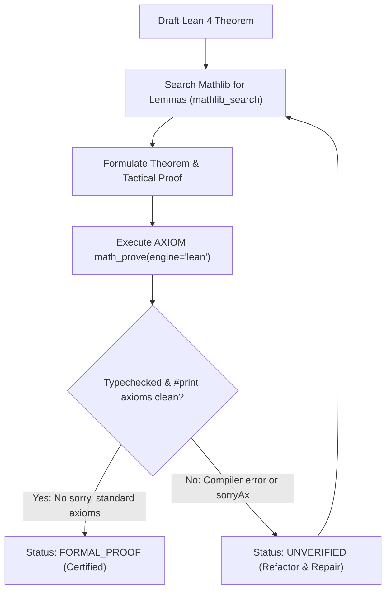

# AXIOM Formal Proofs with Lean 4

Use this skill when tasked with proving, verifying, or auditing mathematical theorems in **Lean 4** and **Mathlib**.

---

## 1. Principles of Formal Verification

1. **The Kernel is Sovereign**: No theorem is considered proven unless it typechecks cleanly under `lean` or `lake env lean` with exit code 0.
2. **Zero Holes**: Proofs containing `sorry`, `admit`, or depending on `sorryAx` are **strictly rejected** as incomplete (`guarantee: unverified`).
3. **Axiom Auditing**: Every audited theorem declaration is subjected to `#print axioms <name>`. Allowed foundational axioms:
   - `propext` (Propositional Extensionality)
   - `Classical.choice` (Axiom of Choice)
   - `Quot.sound` (Quotient Soundness)
   Any user-declared `axiom` or unrecognized axiom flags the proof as `untrusted` and downgrades guarantee to `unverified`.
4. **Sandboxed Execution**: AXIOM executes untrusted Lean code in isolated scratch directories with environment scrubbing (`PATH`, `HOME`, `TMP` sanitized) and resource bounds (2 GB RAM, 100,000 heartbeats, configurable timeout).

---

## 2. Invocation via AXIOM

### Via CLI
```bash
# Verify a Lean file with axiom auditing
axiom prove path/to/theorem.lean --engine lean

# Verify an inline snippet
axiom prove "theorem add_comm (n m : Nat) : n + m = m + n := by omega" --engine lean

# Verify against a canonical Millennium statement
axiom prove path/to/theorem.lean --engine lean --canonical-statement "Navier-Stokes Existence and Smoothness"
```

### Via MCP Server
```json
{
  "name": "math_prove",
  "arguments": {
    "statement": "theorem mul_zero (n : Nat) : n * 0 = 0 := by rfl",
    "engine": "lean"
  }
}
```

---

## 3. Workflow for Agents



1. **Search Prior Art**: Use `mathlib_search` or `axiom mathlib "<query>"` to locate existing theorems and tactics in Mathlib.
2. **Write Self-Contained Declarations**: Ensure typed binders `(n m : Nat)` and implicit typeclasses `[CommRing α]` are explicitly declared.
3. **Execute Verification**: Call `math_prove` with `engine="lean"`.
4. **Inspect Results**:
   - `res.ok == True` and `res.guarantee == "formal-proof"` confirms mathematical certification.
   - If `res.verification.passed == False`, inspect `res.evidence.limitations` and `res.verification.detail` for Lean compiler diagnostics or axiom audit failures.
