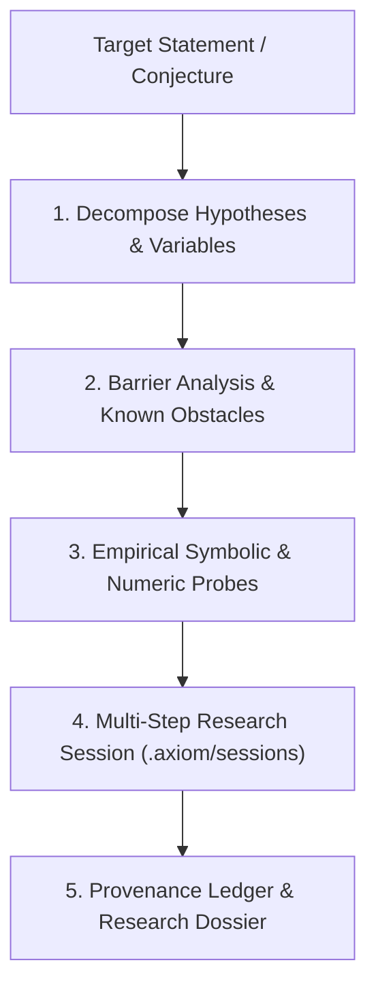

# Mathematical Research & Open Conjecture Investigation

Use this skill when investigating open mathematical problems, difficult conjectures, or theoretical barriers (such as P vs NP, Riemann Hypothesis, Navier-Stokes, or Hodge Conjecture) using AXIOM under the REA paradigm ([ADR-0019](../../docs/adr/0019-mathematical-investigation-layer-rea-paradigm.md)).

---

## 1. Investigation Protocol (The REA Flow)



### Stage 1: Explicit Hypothesis Ledger
Deconstruct the conjecture into atomic mathematical conditions:
- Continuity and regularity class ($C^\infty$, Sobolev space $H^s$).
- Algebraic assumptions (integrality, non-negativity, invertibility).
- Boundary and initial conditions.

### Stage 2: Barrier Cataloging
Before attempting any proof, identify and document established no-go theorems and barriers:
- In **Complexity Theory (P vs NP)**:
  - *Relativization Barrier* (Baker-Gill-Solovay, 1975): Separation cannot be proven by techniques that hold relative to all oracles.
  - *Natural Proofs Barrier* (Razborov-Rudich, 1997): Lower bounds against circuits cannot be proven using properties that are constructive and dense.
  - *Algebrization Barrier* (Aaronson-Wigderson, 2008): Separation cannot be proven by algebraic oracle simulation.
- In **Fluid Dynamics (Navier-Stokes)**:
  - *Enstrophy Blow-up Barrier* (Beale-Kato-Majda criterion): Singularity occurs if and only if $\int_0^T \|\omega\|_{L^\infty} dt = \infty$.

### Stage 3: Multi-Step Derivation Sessions
Record every calculation, transformation, and verification in a persistent AXIOM research session:

```bash
# Create session
axiom session new --name "p-vs-np-barriers" --title "Investigation of Algebraic SAT and Sensitivity Bounds"

# Record step with antecedent dependency
axiom session record --name "p-vs-np-barriers" --step 1 --command "axiom solve '(1 - x)*(1 - y) = 0; x*(1 - y) = 0' -v x,y"
axiom session record --name "p-vs-np-barriers" --step 2 --command "axiom matrix '[[0, 1, 1, 0], [1, 0, 0, 1], [1, 0, 0, -1], [0, 1, -1, 0]]' --op eigen" --depends-on 1

# Check DAG structural validity
axiom session status --name "p-vs-np-barriers"

# Export research markdown dossier
axiom session export --name "p-vs-np-barriers"
```

---

## 2. Research Epistemology Rules

1. **Honest Inconclusiveness**: If a conjecture cannot be proven or refuting counterexamples cannot be found within available computation, report status as **Inconclusive** (`guarantee: unverified`). Never hallucinate closure.
2. **Weakest-Link Invariant**: The overall guarantee of a research chain is limited by its weakest component:
   $$\text{Chain Guarantee} = \min_{i} \text{Guarantee}(step_i)$$
   A chain containing 10 formal proofs and 1 heuristic step has overall chain guarantee **`heuristic`**.
