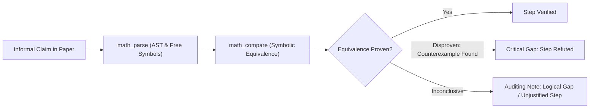

# Mathematical Proof Auditing & Gap Detection

Use this skill when tasked with critically evaluating an academic preprint, a candidate proof of a known conjecture, or an informal mathematical derivation.

---

## 1. Auditing Methodology

When auditing an informal mathematical manuscript:

1. **Extract Core Lemmas**: Transcribe the sequence of claims from the paper into individual equations and assertions.
2. **Isolate Logical Transitions**: For every deduction *"Therefore $A \implies B$"*, verify whether $B$ strictly follows from $A$ or if additional lemmas are assumed.
3. **Audit Domain Constraints**:
   - Are divisions protected by non-zero proofs ($x \neq 0$)?
   - Are square roots, logarithms, and powers evaluated on branch cuts or non-positive domains?
   - Are infinite sums, limits, or integrals exchanged without proving uniform convergence (dominated convergence theorem, Fubini's theorem)?
4. **Spot Common Fallacies**:
   - *Circular reasoning*: Assuming the conclusion or an equivalent formulation in a helper lemma.
   - *Quantifier swaps*: Exchanging $\forall x \exists y$ with $\exists y \forall x$.
   - *Asymptotic overreach*: Extrapolating $O(1)$ bounds from finite samples without uniform estimates.

---

## 2. AXIOM Auditing Pipeline



### Example Audit Steps with AXIOM

1. **Test Equivalence of a Reduction Step**:
   ```bash
   # Paper claims: sqrt(x^2) = x
   axiom compare "sqrt(x^2)" "x"
   # AXIOM reveals counterexample x = -1, unless x:positive is assumed!
   ```

2. **Verify Solution Set Completeness**:
   ```bash
   # Paper claims candidate roots are {2, 3} for x^2 - 5x + 6 = 0
   axiom verify "x^2 - 5*x + 6 = 0" --solutions "2,3"
   ```

3. **Check Definite Integration Limits**:
   ```bash
   # Paper computes definite integral with interior singularity
   axiom integrate "1/x^2" --variable x --from -1 --to 1
   # AXIOM rejects with unverified/divergent due to pole at x=0
   ```

---

## 3. Epistemic Audit Report Format

When delivering an audit report to the user:
- Classify each section as:
  - **[VERIFIED]**: Verified algebraically or formally.
  - **[CONDITIONALLY VALID]**: Valid only with explicitly declared missing assumptions (e.g. $x > 0$).
  - **[GAP]**: Step lacks mathematical justification or counterexample discovered.
  - **[FATAL]**: Contradiction found or reliance on a refuted lemma.
